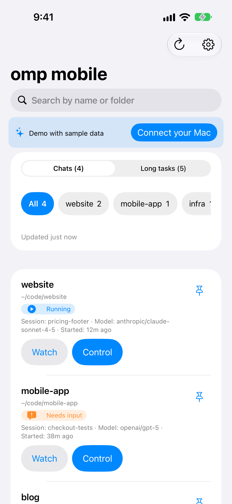
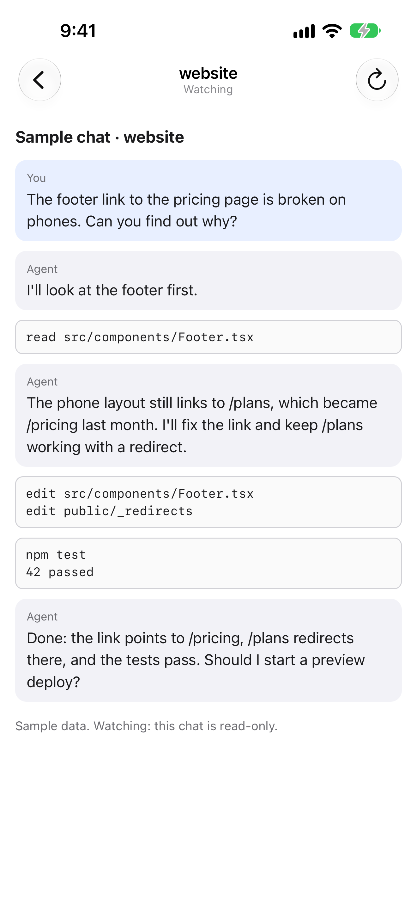
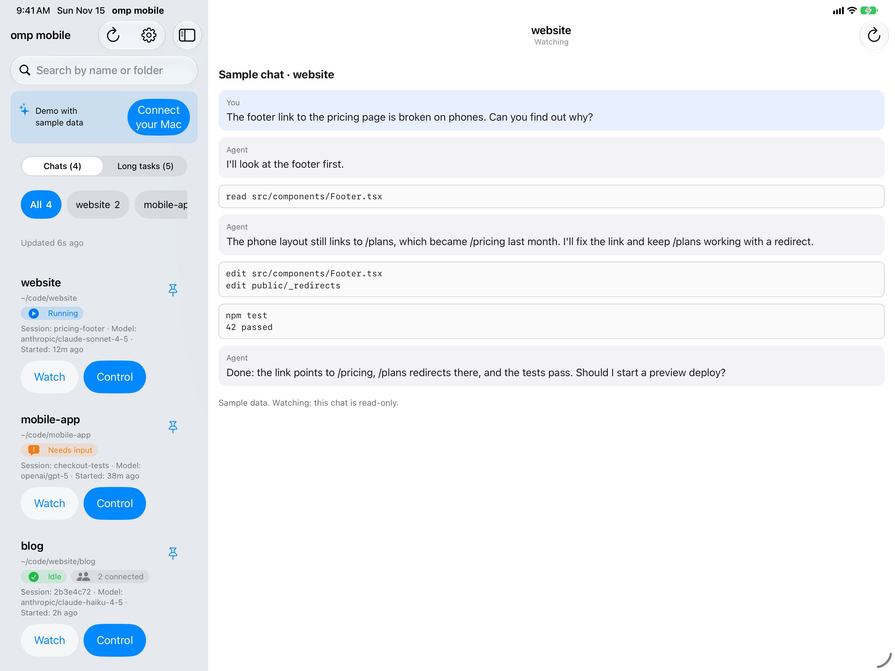

# omp-mobile

An iPhone and iPad companion for the [omp](https://github.com/can1357/oh-my-pi) chats on your Mac, over Tailscale. See every chat that shares itself, watch one or take control of it, start new ones, and keep long-running chats at hand as long tasks.

<p>
  
  
</p>
<p>
  
</p>

The screenshots show the app's demo, which runs on made-up chats and needs no Mac.

omp-mobile has two parts:

- `server/`: a Bun server on the Mac. It lists the omp chats that share themselves through omp Collab, mints Watch and Control links, keeps pinned chats as long tasks, serves a phone web page and, once set up, sends push notifications to the app. See [server/README.md](server/README.md).
- `ios/`: the SwiftUI app for iPhone and iPad, and OmpKit, the Swift package it builds on. See [ios/README.md](ios/README.md).

`api/v1/` describes the server's HTTP API, with an example of each request and reply ([api/v1/README.md](api/v1/README.md)).

Status: 0.1.0, the first release. The app is not in the App Store yet; build it from `ios/`.

## What you need

- A Mac with omp and [Bun](https://bun.sh).
- [Tailscale](https://tailscale.com) on the Mac and on the iPhone or iPad, signed in with a login the server allows. The Mac publishes the server to your tailnet with `tailscale serve`.
- An iPhone or iPad with iOS 26 or later.
- To build the app: Xcode 27 or later on macOS 26 or later.
- Optional: cmux, for New session, Reopen and the sidebar groups; a paid Apple Developer Program team, for push notifications.

## How it fits together

```text
iPhone or iPad --Tailscale--> tailscale serve on the Mac (HTTPS; sets Tailscale-User-Login)
                                  |
                                  v
                  server on 127.0.0.1:7478 --> omp collab list / link, cmux
Watch or Control tab --> Collab page (the server's page copy, or my.omp.sh)
                     --> omp's relay, encrypted end to end --> the chat on the Mac
```

The server listens on `127.0.0.1` only. `tailscale serve` publishes it to your tailnet and tells it the Tailscale login of each request, and the server answers only the logins in its config file.

## Security

Control links, New session and Manage run commands on your Mac as you, so whoever can use the dashboard can use your Mac. Publish the server only with `tailscale serve`, never with Tailscale Funnel or any other public address, and list only your own logins in `allowedLogins`. See "Security" in [server/README.md](server/README.md).

## Quick start

### The server

On the Mac:

1. Let omp share its sessions: `omp config set collab.autoStart control`, and the same with `OMP_PROFILE=<name>` in front for each other profile you use.
2. Copy `server/config.example.json` to `~/.config/omp-mobile/config.json`, and set `publicUrl` and `allowedLogins`.
3. In `server/`, run `bun install`, then `scripts/install-launchd.sh`, which starts the server now and at every login.
4. Publish it to your tailnet: `tailscale serve --bg 7478`.
5. With Tailscale connected on the phone, open the `publicUrl` address in the browser. That is the phone web page.

[server/README.md](server/README.md) explains each part, the config file and the optional modules, push notifications included.

### The app

1. Open `ios/OmpMobile.xcodeproj` in Xcode and run the `OmpMobile` scheme on a simulator.
2. To run it on your own iPhone or iPad, copy `ios/Config/Local.example.xcconfig` to `ios/Config/Local.xcconfig`, set `DEVELOPMENT_TEAM` to your Apple team id and `OMP_BUNDLE_ID_PREFIX` to a prefix of your own, then pick your device in Xcode and run.
3. At first run, type the server's address, the name `tailscale serve` gives your Mac (like `my-mac.example.ts.net`), and tap Connect. Try the demo shows the app with sample data instead.

[ios/README.md](ios/README.md) covers push notifications, release builds and the checks.

## More

- [server/README.md](server/README.md): the server, the phone page, the config file and the local API.
- [api/v1/README.md](api/v1/README.md): the HTTP API.
- [ios/README.md](ios/README.md): the app and OmpKit.
- [docs/decisions.md](docs/decisions.md): dated design decisions.
- [PRIVACY.md](PRIVACY.md): the app's privacy policy.
- [CHANGELOG.md](CHANGELOG.md): what each release changed.

## License

MIT, see [LICENSE](LICENSE). [server/THIRD_PARTY_NOTICES.md](server/THIRD_PARTY_NOTICES.md) lists the code of others this repository carries.
